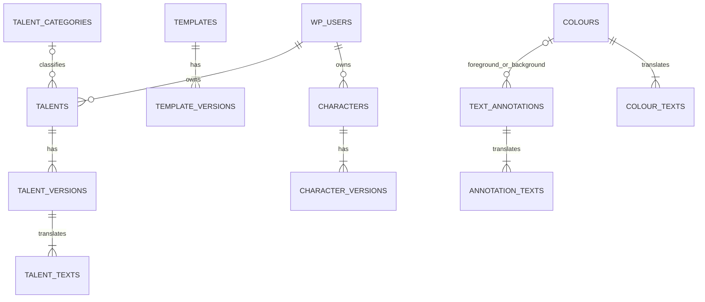

# Projekt bazy danych

Status: model logiczny, aktualizacja 2026-11-07. Lokalnie utworzono już tabele kolorów, oznaczeń i szablonów z wersjami oraz techniczną tabelę rewizji katalogu. Ich wdrożony zakres opisuje [Baza danych](Baza%20danych.md); pozostałe tabele są nadal propozycją, bez wdrożonych migracji.

## Podstawa projektu

Ustalenia nowej aplikacji: [Zakres prac](Zakres%20prac.md). Sprawdzono dokumentację starego projektu oraz aktualne struktury w `TalentLibrary.tsx`, `LayeredTemplateEditor.tsx`, `GlobalFieldDefinitions.tsx`, `UserClanEditor.tsx`, `cardTemplates/definicje-pol.json` i `cardTemplates/talenty/szablon.json`.

W starym projekcie:

- Talent ma stałe ID, nazwę, dwa opisy, użycia, flagi, grupę, podgrupę, typ administracyjny i opcjonalny kod nagrody.
- Wygląd talentów pochodzi ze wspólnego szablonu. Grupa nie określa wyglądu ani flag.
- Projekt karty zawiera warstwy, elementy i warianty. Pola mają globalne definicje; pozycja należy do szablonu, a wartość do postaci.
- Materiały graficzne i PDF-y są plikami; JSON przechowuje odwołania i konfigurację.
- Rejestr nagród i odbiorców jest oddzielony od biblioteki talentów.

To punkt odniesienia, nie automatyczne zatwierdzenie wszystkich dawnych funkcji. Stary projekt i jego pliki pozostają bez zmian.

## Główna propozycja

Wspólna baza WordPressa, osobne tabele edytora. Logowanie, konta i uprawnienia pozostają w WordPressie. Nie tworzymy drugiej tabeli użytkowników ani haseł.

Dane wyszukiwane, sortowane i łączone zapisujemy w kolumnach i relacjach. Złożone dokumenty graficzne zapisujemy jako wersjonowany JSON. Nie zapisujemy całej biblioteki talentów ani wszystkich postaci w jednym JSON-ie.

Nazwy poniżej mają umowny prefiks `ke_`. Fizyczne nazwy powstaną z `$wpdb->prefix`, np. `wp_ke_talents`. Nie zakładamy na sztywno prefiksu `wp_`.

## Wspólne zasady

- Wewnętrzny klucz: `BIGINT UNSIGNED`. Zewnętrzny identyfikator: niezmienny UUID, z unikalnym indeksem. Nazwa wyświetlana nie jest identyfikatorem.
- Właściciel i autor wskazują `users.ID` WordPressa. `owner_user_id = NULL` oznacza materiał redakcyjny; właściciel nie zastępuje uprawnienia do operacji.
- Daty zapisujemy w UTC. Tabele używają InnoDB i kodowania `utf8mb4`; dokładną kolację dobierzemy do środowisk DEV i PROD.
- Każdy główny obiekt ma `created_at`, `updated_at`, `created_by`, `updated_by` i `lock_version`. Warunkowa aktualizacja numeru blokuje nadpisanie cudzych zmian.
- Zapisy obejmujące kilka tabel są transakcyjne. Unikalność chronią indeksy, nie tylko sprawdzenie formularza.
- Proponujemy archiwizację zamiast zwykłego kasowania obiektów używanych w zapisanych materiałach. Usuwanie kont i prywatnych danych wymaga oddzielnej procedury; archiwizacja nie zastępuje ich usunięcia.
- Statusy i rodzaje zapisujemy jako kontrolowane wartości tekstowe, walidowane przez API. Nie tworzymy nowych zasad gry na podstawie schematu bazy.

## Relacje



Diagram pokazuje główne relacje. Odwołania wewnątrz dokumentów szablonów i postaci dodatkowo sprawdza API.

## 1. Biblioteka talentów — pierwszy etap

### `ke_talent_categories` i `ke_talent_category_texts`

Kategorie zastępują grupy i podgrupy zapisane tekstem przy każdym talencie.

| Tabela | Ważne pola |
| --- | --- |
| `ke_talent_categories` | `id`, `uuid`, `parent_id NULL`, `sort_order`, `archived_at NULL` |
| `ke_talent_category_texts` | `category_id`, `language`, `name` |

Grupa ma pustego rodzica, podgrupa wskazuje grupę. Na początek dopuszczamy dwa poziomy. Talent wskazuje podgrupę, a jeśli jej nie ma — grupę. Grupy i podgrupy mają znaczenie administracyjne; nie nadają mechaniki ani dostępu.

Unikalność tłumaczenia: `(category_id, language)`. API pilnuje braku cykli, poprawnej głębokości i duplikatów nazw w tym samym miejscu drzewa.

### `ke_talents`

Stała tożsamość talentu i dane potrzebne do listy oraz kontroli dostępu.

| Pole | Znaczenie |
| --- | --- |
| `id`, `uuid` | Wewnętrzny klucz i stały identyfikator talentu. |
| `owner_user_id NULL` | Konto autora prywatnego talentu lub materiał redakcyjny. |
| `category_id NULL` | Grupa albo podgrupa. Wymagalność ustalimy dla redakcji i użytkownika osobno. |
| `visibility` | Proponowane: `private`, `public`, `restricted`. Sam status publikacji nie nadaje dostępu. |
| `current_version_id` | Ostatnia zapisana wersja, także robocza. |
| `published_version_id NULL` | Wersja udostępniona użytkownikom; nowszy szkic jej nie zastępuje. |
| `archived_at NULL` | Ukrycie w bieżącej ofercie bez zrywania dawnych odwołań. |

Wskaźniki wersji muszą prowadzić do wersji tego samego talentu. Nowy talent i jego pierwszą wersję tworzymy w jednej transakcji; wskaźnik może być pusty tylko podczas tej transakcji.

### `ke_talent_versions`

Niezmienna wersja parametrów talentu.

| Pole | Znaczenie |
| --- | --- |
| `id`, `talent_id`, `version_no` | Klucz wersji, talent i kolejny numer. |
| `uses_per_mission` | Odpowiednik `usesPerMission`; obecnie 0–3. |
| `once_per_scene` | Odpowiednik `oncePerScene`. |
| `is_dark_gift`, `is_action` | Jawne flagi, niezależne od kategorii. |
| `dev_type NULL` | Obecny typ administracyjny; nie wybiera szablonu. Na początek tekst, osobny słownik dopiero jeśli potrzebny. |
| `schema_version`, `created_at`, `created_by` | Wersja formatu, data i autor zapisu. |

Unikalność `(talent_id, version_no)`. Nie przechowujemy tu kodu nagrody ani e-maila. Zapis tworzy nową wersję zamiast modyfikować poprzednią. Limity użyć przenosimy ze źródła; zależność „raz na scenę” i „na misję” wymaga ustalenia walidacji, ponieważ stara aplikacja pozwalała zaznaczyć oba.

### `ke_talent_texts`

| Pole | Znaczenie |
| --- | --- |
| `talent_version_id`, `language` | Unikalna para wersji i języka: `pl` albo `en`. |
| `name` | Nazwa talentu w danym języku. |
| `flavor_description` | Opis fabularny. |
| `description` | Opis działania. |

Zachowujemy źródłowe znaczniki formatowania. Nie zapisujemy wygenerowanego HTML ani miękkich łączników dodanych przez renderer. Zmiana któregokolwiek tłumaczenia tworzy nową wersję talentu z kompletem zachowanych tłumaczeń.

Brak EN oznacza brak tłumaczenia, nie automatyczne tłumaczenie PL. Publikację wersji z niekompletnymi językami i ewentualny widoczny fallback ustalimy przed wdrożeniem.

### Historia zmian talentów — wymaganie wewnętrznego edytora

- Zapamiętujemy kto, kiedy i co zmienił w talencie. Historia jest dostępna wyłącznie uprawnionym osobom w naszym wewnętrznym edytorze. Nie jest wymaganą funkcją części dla klientów i nie udostępniamy jej w ich API.
- Wersje talentu zachowują wcześniejsze treści PL/EN i parametry. Porównanie wersji pokazuje zmienione pola.
- Proponowana tabela `ke_talent_events`: `id`, `talent_id`, `actor_user_id`, `occurred_at`, `action`, `from_version_id NULL`, `to_version_id NULL`, `changes JSON`. Indeks: `(talent_id, occurred_at, id)`.
- Rejestr obejmuje także zmiany poza treścią: kategorię, widoczność, publikację i archiwizację. `changes` zachowuje poprzednie i nowe wartości zmienionych pól; przy zmianie treści wskazujemy zachowane wersje zamiast kopiować całe opisy do zdarzenia.
- Autora i czas ustala serwer z sesji WordPressa; nie przyjmuje ich jako dowolnych wartości z formularza. Zapis talentu, wersji i zdarzenia wykonujemy w jednej transakcji. Historia nie jest nadpisywana podczas kolejnej edycji.
- To historia redakcyjna talentów, odrębna od opisanej wcześniej historii własnych zapisów użytkownika. Przywracanie dawnej wersji nie zostało jeszcze ustalone.

## Wspólne kolory i oznaczenia tekstu

Lokalnie wdrożono cztery tabele opisane poniżej i dodatkową ke_catalogue_state (id=1, lock_version), zapewniającą wspólną rewizję transakcyjnego zapisu całego katalogu.

To osobne słowniki dla całego edytora, niezależne od definicji pól szablonu. Docelowo nie mają właściciela użytkownika; ich edycja wymaga praw projektowania. Obecny zapis w `localStorage` dla konta jest wyłącznie rozwiązaniem prototypowym.

### `ke_colours` i `ke_colour_texts`

| Tabela | Ważne pola |
| --- | --- |
| `ke_colours` | `id`, `uuid`, `rgb_r`, `rgb_g`, `rgb_b`, `cmyk_c NULL`, `cmyk_m NULL`, `cmyk_y NULL`, `cmyk_k NULL`, `sort_order`, `archived_at NULL`, pola autorstwa i blokady |
| `ke_colour_texts` | `colour_id`, `language`, `name` |

- RGB: trzy liczby całkowite 0–255. HEX jest reprezentacją tych samych kanałów w API i interfejsie, bez drugiej niezależnej wartości w bazie.
- CMYK: cztery wartości procentowe 0–100, proponowany typ `DECIMAL(5,2)`. Albo wszystkie są określone, albo wszystkie są `NULL` (brak ustalonego CMYK).
- RGB i CMYK zapisujemy niezależnie. Zmiana jednego nie przelicza drugiego automatycznie. Obecne ręczne przeliczenie bez profilu ICC jest orientacyjne; podgląd korzysta z RGB. Profil druku i eksport CMYK ustalimy osobno.
- Unikalność tłumaczenia: `(colour_id, language)`. Zmiana nazwy lub wartości koloru nie zmienia jego ID. Usunięcie koloru używanego przez oznaczenie jest blokowane; najpierw trzeba zmienić odwołanie. Archiwizacja nie zrywa istniejących odwołań.

### `ke_text_annotations` i `ke_text_annotation_texts`

| Tabela | Ważne pola |
| --- | --- |
| `ke_text_annotations` | `id`, `uuid`, `tag UNIQUE`, `text_colour_id NULL`, `background_colour_id NULL`, `font_weight`, `italic`, `underline`, `small_caps`, `sort_order`, `archived_at NULL`, pola autorstwa i blokady |
| `ke_text_annotation_texts` | `annotation_id`, `language`, `name` |

- `tag` jest stałym, unikalnym znacznikiem niezależnym od nazwy PL/EN, np. `cecha`, `aspekt`, `stan`. Pozwala odczytać `[cecha: krzepy]` bez zapisywania polskiej nazwy stylu jako klucza. Po zapisie nie zmieniamy znacznika.
- Zachowujemy także skróty `**tekst**` i `*tekst*`, odpowiadające wpisom o znacznikach `**` i `*`. API sprawdza składnię i jednoznaczność znaczników.
- Kolor tekstu i tła wskazują `ke_colours.id`. Brak koloru tekstu oznacza dziedziczenie, brak koloru tła — przezroczystość. Grubości na teraz: 400, 600, 700; nie zapisujemy dodatkowego pola `bold`, bo dublowałoby grubość 700.
- Oznaczenia nie zawierają wielkości czcionki ani osobnych wariantów stylu dla szablonów. Rozmiar pochodzi z tekstu szablonu. Zmiana stylu lub koloru aktualizuje bieżące renderowanie wszystkich korzystających z niego materiałów.
- Unikalność tłumaczenia: `(annotation_id, language)`. Usuwanie lub archiwizacja oznaczenia nie może pozbawić znaczenia znaczników zapisanych w starszych wersjach talentów. Używane oznaczenia zachowujemy do odczytu.

Początkowe wpisy odpowiadają staremu edytorowi:

| Znacznik | Nazwa PL | Styl |
| --- | --- | --- |
| `cecha` | Cecha | Grubość 700 i kursywa. |
| `aspekt` | Aspekt | Tło wskazujące kolor RGB `#b1b7c6`; CMYK początkowo nieustalone. |
| `stan` | Stan | Kapitaliki, grubość 600, bez kursywy. |
| `**` | Pogrubienie | Grubość 700. |
| `*` | Kursywa | Kursywa. |

Treści `ke_talent_texts` przechowują znaczniki źródłowe, bez kopii parametrów stylu i bez HTML. Renderer rozpoznaje znacznik i pobiera wspólny styl; API waliduje nowe oznaczenia przy zapisie. Nieznanego znacznika przy imporcie nie usuwamy po cichu — raportujemy go do mapowania. Definicje oznaczeń i kolorów nie należą do `ke_template_versions.document`.

Historia talentu pokazuje zmianę jego treści, a nie globalnego wyglądu. Dawna wersja talentu wyrenderowana aktualnymi stylami może wyglądać inaczej. Odtwarzanie historycznego wyglądu wymagałoby dodatkowego utrwalenia stylów, kolorów i renderera; sposób takiego zapisu ustalimy przy eksporcie. Nie dodajemy teraz nieuzgodnionych tabel historii stylów.

## 2. Kreatory szablonów

### `ke_templates` i `ke_template_versions`

Jeden mechanizm zapisu, różne rodzaje dokumentów i interfejsy kreatorów.

| Tabela | Ważne pola |
| --- | --- |
| `ke_templates` | `id`, `uuid`, `kind`, `name`, `current_version_id`, `published_version_id NULL`, `archived_at NULL`, pola autorstwa i blokady |
| `ke_template_versions` | `id`, `template_id`, `version_no`, `schema_version`, `document JSON`, `created_at`, `created_by` |

Rodzaje na początek: `talent_card` i `character_card`. Rozróżnienie karty klanu i archetypu oraz warianty znajdują się w dokumencie projektu. Nie zakładamy stałych limitów liczby klanów ani archetypów.

Dokument JSON (fizycznie `LONGTEXT` z walidacją API) obejmuje:

- Format, wymiary i jednostki. Dla obecnych kart używamy punktów PDF i początku współrzędnych w lewym górnym rogu.
- Warstwy: stałe ID, kolejność, nazwy, widoczność i blokady.
- Warianty: stałe ID, metadane i powiązane materiały PL/EN.
- Elementy: stałe ID, rodzaj, pozycję, rozmiary, warstwę, kolejność, przypisania do wariantów i właściwości graficzne.
- Teksty stałe w PL/EN, parametry typografii, flagi i ustawienia wspólnego renderowania.
- Odwołania do załączników WordPressa i konkretnych wersji talentów.
- Definicje pól należące do szablonu: typy, stałe identyfikatory, etykiety PL/EN, sposób zliczania oraz ustawienia wyglądu. Są zapisywane razem z wersją szablonu.

To dokument edytowany i ładowany jako całość, dlatego na początek nie rozbijamy każdej współrzędnej i warstwy na osobne tabele. Nie planujemy filtrowania biblioteki po współrzędnych. Jeśli później będzie potrzebne wyszukiwanie zależności między szablonami i materiałami, dodamy relacyjną tabelę tych odwołań.

Może istnieć kilka szablonów korzystających z tych samych talentów. Talent nie zawiera własnej kopii szablonu ani stylów oznaczeń. Wybrany szablon określa układ i typografię tekstu, w tym wielkość czcionki. Oznaczenia fragmentów wyglądają jednakowo we wszystkich szablonach, z rozmiarem dziedziczonym z otaczającego tekstu. Miejsce zapisu wyboru szablonu doprecyzujemy przy podłączaniu edytora talentów; nie wiążemy talentu na stałe z jednym szablonem.

### Definicje pól jako elementy szablonu

Definicje pól są częścią dokumentu `ke_template_versions.document`, a nie osobną globalną biblioteką. Nie tworzymy tabel `ke_field_definitions` ani `ke_field_definition_texts`.

- Każda definicja należy do konkretnego szablonu i jest wersjonowana razem z nim.
- Zawiera stałe ID, klucz semantyczny, typ, etykiety PL/EN, sposób zliczania i ustawienia wyglądu. Na początek typy odpowiadają źródłu: `text` i `checkbox`.
- Rozdzielamy ID definicji w szablonie od ID jej wystąpienia na karcie. Wystąpienie określa pozycję, warstwę i warianty. Odwołania między nimi są lokalne dla danego szablonu.
- Dane postaci przechowują wartości pól, a nie ich definicje. Identyfikację zapewnia wersja szablonu oraz stałe ID definicji i wystąpień pól.
- Zmiana definicji tworzy nową wersję szablonu. Nie zmienia innych szablonów ani wcześniej zapisanych kart.
- Przy imporcie stare globalne definicje kopiujemy do odpowiednich szablonów, zachowując ich identyfikatory i powiązania. Źródłowych plików nie zmieniamy.

## 3. Dane użytkowników — dalszy etap

### `ke_characters` i `ke_character_versions`

| Tabela | Ważne pola |
| --- | --- |
| `ke_characters` | `id`, `uuid`, `owner_user_id NOT NULL`, `name`, `current_version_id`, `archived_at NULL`, pola dat i blokady |
| `ke_character_versions` | `id`, `character_id`, `version_no`, `schema_version`, `document JSON`, `created_at`, `created_by` |

Wersja postaci zawiera dane oraz uporządkowaną listę kart. Każda karta wskazuje konkretną wersję szablonu i wariant. Wartości są powiązane ze stałymi identyfikatorami definicji i wystąpień pól, nigdy z ich polskimi etykietami. Odwołania do talentów wskazują konkretne wersje. Zmiana szablonu nie przesuwa samoczynnie pól zapisanej postaci; aktualizacja postaci do nowej wersji jest osobną operacją.

Przykładowy kształt dokumentu, bez narzucania pól mechaniki:

```json
{
  "schemaVersion": 1,
  "cards": [
    {
      "id": "stale-id-karty-w-postaci",
      "templateVersionId": 101,
      "variantId": "id-wariantu",
      "values": {}
    }
  ],
  "talentVersionIds": []
}
```

Historia zapisów wynika z wersji. Historia samych otwarć i kliknięć nie jest tym samym i nie jest obecnie proponowana. Jeśli potrzebne będzie wyszukiwanie po cechach wewnątrz postaci, wydzielimy wskazane wartości do indeksowanych kolumn lub tabel po określeniu konkretnych filtrów.

### Zestawy talentów i cechy arkusza — projekt bazy odłożony

To potwierdzona, ważna funkcja: zestaw obejmuje listę wybranych talentów oraz cechy arkusza. Konkretnych cech jeszcze nie ustalono.

Na polecenie użytkownika nie projektujemy teraz tabel, kolumn, relacji ani indeksów dla tej funkcji. Wcześniejsza propozycja `ke_talent_sets` i `ke_talent_set_items` została wycofana. Model danych opracujemy, kiedy przejdziemy do etapu zestawów i arkuszy.

Gość pracuje bez zapisu do tabel użytkownika. Stan bieżącej pracy może pozostawać w pamięci aplikacji; nie tworzymy po cichu kont ani trwałej historii gości. Eksport plików i ewentualne przeniesienie rozpoczętej pracy po zalogowaniu wymagają osobnego ustalenia.

## 4. Rozszerzenia, których nie wdrażamy automatycznie

| Proponowana tabela | Kiedy i po co |
| --- | --- |
| `ke_talent_claims` | Jeśli przeniesiemy odbiór ekskluzywnych nagród: `talent_id UNIQUE`, `code_hash UNIQUE`, `claimed_by_user_id NULL`, daty i status. Kod nie jest UUID talentu. Zgodnie ze źródłem jedna nagroda ma jednego odbiorcę. Kod pokazujemy/obsługujemy wyłącznie uprawnionemu odbiorcy; nie zwracamy go w bibliotece publicznej. |
| `ke_import_map` | Podczas migracji: `source_system`, `entity_type`, `source_id`, `target_uuid`, suma kontrolna źródła, data. Unikalne `(source_system, entity_type, source_id)` zapewnia powtarzalność. Zachowujemy również tekstowe ID starsze niż UUID. |
| `ke_exports` | Jeśli historia ma obejmować wygenerowane PDF-y: właściciel, typ, język, dokładne wersje wejściowe, wersja renderera, identyfikator prywatnego pliku, status i data. Nie zapisujemy binarnych PDF-ów w bazie. |

Samo posiadanie kodu nagrody nie musi oznaczać prawa do dowolnego talentu; sposób potwierdzania odbiorcy i wiązania z kontem wymaga decyzji. Surowa lista mailingowa, SMTP i materiały wysyłkowe pozostają w starym projekcie. Ich przeniesienie nie jest częścią obecnego zakresu.

## Pliki i odtwarzanie wyglądu

Wspólne grafiki i fonty mają stałe odwołania do zasobów lub Mediów WordPressa. Nie zapisujemy ścieżek Windows ani domeny DEV jako identyfikatorów. Wersja opublikowanego szablonu musi zachować użyte wersje zasobów: nie podmieniamy pliku załącznika w miejscu bez utworzenia nowego zasobu.

Prywatnych PDF-ów postaci nie udostępniamy zwykłym publicznym URL-em biblioteki Mediów. Plik pobiera kontroler sprawdzający właściciela i uprawnienia. Zapisane wersje danych i szablonów pomagają odtworzyć dokument; identyczny wynik graficzny wymaga także zachowania zasobów i wersji renderera. Jeśli potrzebny jest dokładnie ten sam plik, zachowujemy wygenerowany PDF.

## Wyszukiwanie, sortowanie i indeksy

Proponowane indeksy oprócz kluczy głównych i unikalnych UUID:

| Operacja | Indeks/podejście |
| --- | --- |
| Biblioteka redakcyjna/prywatna | `ke_talents(owner_user_id, archived_at, id)`; dodatkowo `(category_id, archived_at, id)` i `(visibility, archived_at, id)` po ustaleniu zapytań. |
| Wersje talentu | `UNIQUE(talent_id, version_no)`; analogicznie dla szablonów i postaci. |
| Nazwa w języku | `ke_talent_texts(language, name, talent_version_id)`; długość kolumny nazwy ustalimy przed SQL. |
| Moje postacie | `ke_characters(owner_user_id, archived_at, updated_at, id)`. |
| Oznaczenia i kolory | `UNIQUE(tag)` dla oznaczeń; unikalne pary obiekt/język w tabelach nazw; indeksy obu odwołań koloru w oznaczeniach. |
| Kategorie | `(parent_id, sort_order, id)` i unikalne tłumaczenie dla kategorii i języka. |

Filtrowanie, sortowanie i stronicowanie dużych list wykonuje API w SQL. Sortowanie ma stabilny drugi klucz `id`. Dla list chronologicznych można stosować paginację po kursorze; inne porządki dobierzemy do interfejsu. API dopuszcza wyłącznie znane pola sortowania i ogranicza rozmiar strony.

Indeks nazwy pomaga w sortowaniu i wyszukiwaniu po początku nazwy, nie rozwiązuje zapytań `LIKE '%tekst%'` po długich opisach. Pełnotekstowe wyszukiwanie opisów i wymagania dotyczące polskich odmian wyrazów ocenimy osobno. Nie dokładamy indeksu do każdej flagi bez sprawdzenia rzeczywistych zapytań i planu `EXPLAIN`.

## Dostęp i spójność

- API filtruje dane po właścicielu i prawach również przy odczycie pojedynczego ID. Znajomość UUID nie nadaje dostępu.
- Użytkownik nie wybiera dowolnego `owner_user_id` w żądaniu. Serwer ustala konto z sesji WordPressa.
- Szkice, prywatne talenty i nagrody nie mogą trafić do publicznej listy ani publicznego cache.
- Kontrola schematu JSON obejmuje wielkość, typy, istnienie odwołań, przynależność wersji i dozwolone zasoby. JSON nie jest dowolnym HTML-em ani kodem do wykonania.
- Relacje wewnątrz edytora zabezpieczamy kluczami obcymi w migracjach SQL. Referencje do użytkowników i załączników WordPressa obsługujemy przez API i procedury usuwania, bez ingerencji w schemat tabel WordPressa.
- Usunięcie nieużywanej wersji może być możliwe administracyjnie; wersje przywołane przez zapisane postacie, zestawy i eksporty pozostają chronione. Odwołania zawarte w JSON sprawdza procedura usuwania.

## Migracje i import starego projektu

1. Wersję schematu bazy przechowujemy w opcji wtyczki. Numerowane migracje uruchamiamy jawnie na lokalnym środowisku, po kopii danych; aktywacja wtyczki nie importuje biblioteki.
2. Przed produkcją przygotowujemy sprawdzoną procedurę aktualizacji schematu. Nie podmieniamy całej bazy WordPressa lokalną bazą.
3. Import czyta kopię wybranych danych źródłowych i pokazuje podgląd mapowania. Nie zmienia źródła.
4. Zachowujemy oryginalne UUID talentów, pól, warstw i elementów tam, gdzie występują, albo zapisujemy jednoznaczne mapowanie. Nie dopasowujemy rekordów wyłącznie po nazwie.
5. Mapujemy `group/subgroup` na kategorie, teksty na PL, flagi na kolumny wersji, projekty na dokumenty szablonów. Brak EN pozostaje brakiem tłumaczenia. `code` trafia tylko do osobnego mechanizmu nagród, jeśli zostanie objęty migracją.
6. Powtórny import nie nadpisuje lokalnych edycji bez decyzji użytkownika; porównujemy mapowanie i sumę kontrolną źródła. Błędy blokują zatwierdzenie importu.
7. Porównujemy liczbę rekordów, identyfikatory, treści, flagi, zależności oraz próbne podglądy i eksporty.

## Kolejność realizacji

Najpierw biblioteka talentów: tabela historii `ke_talent_events` oraz pięć tabel `ke_talent_categories`, `ke_talent_category_texts`, `ke_talents`, `ke_talent_versions`, `ke_talent_texts`. Przed podłączeniem renderowania oznaczeń dodamy wspólne słowniki `ke_colours`, `ke_colour_texts`, `ke_text_annotations`, `ke_text_annotation_texts`. Następnie szablony wraz z należącymi do nich definicjami pól. Tabele postaci, zestawów i rozszerzeń wdrażamy dopiero wraz z ich funkcjami.

Przed napisaniem SQL doprecyzujemy przede wszystkim: pola i filtry biblioteki talentów, zasady publikacji PL/EN, zakres historii oraz obsługę talentów prywatnych i ekskluzywnych. Osobnym tematem pozostaje sposób generowania PDF na docelowym hostingu — stary renderer używa Chromium, którego dostępności na hostingu WordPressa nie potwierdzono. Ten projekt bazy nie rozstrzyga wyboru renderera.

## Biblioteka talentów — struktura startowa

Pierwsza grupa: Talenty archetypów. Podgrupy: Egzorcysta, Inkwizytor, Kronikarz, Rzecznik, Siepacz, Szabrownik, Wiedźmiarz, Żarmistrz, Żerca. Hierarchia i sposób pracy zatwierdzone w dokumencie [Biblioteka talentów](Biblioteka%20talentów.md). Zgodnie z poleceniem użytkownika na tym etapie bez kodowania i bez tworzenia tabel lub rekordów grup.
## Aktualizacja implementacji — 2026-11-09

Uruchomiono lokalnie zapis talentów: ke_talents, ke_talent_versions, ke_talent_texts, ke_talent_events. Faktyczny schemat/API i jawna inicjalizacja opisane w [Bazie danych](Baza%20danych.md). To pierwszy zapis redakcyjny: obowiązkowa podgrupa, wersjonowane treści PL/EN i parametry w dokumencie ustawień, odwołanie do szablonu korzystające z jego aktualnego układu, kontrola konfliktów, kto/kiedy/zmienione pola. Obecne usage dopuszcza wyłącznie brak/raz na misję/trzy razy na misję/raz na scenę. Nie wdrożono jeszcze projektowanych owner/visibility/published_version ani osobnych kolumn parametrów mechanicznych. Nie zmieniano zakresu przyszłych zestawów i nie utworzono ich tabel.
